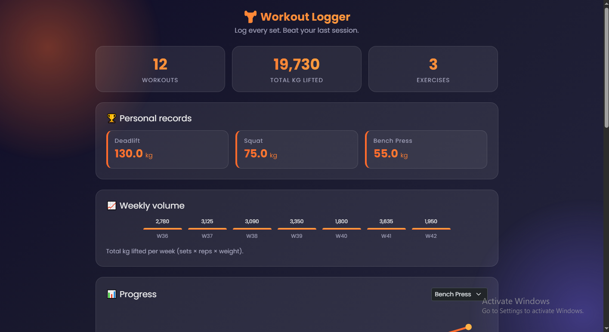

# Workout Logger
#### Video Demo: https://youtu.be/7CsV8kyAOyQ?si=n65wlUTiDBx0OgwO
#### Description:

Workout Logger is a small app for tracking gym workouts. You log an exercise with its sets, reps and weight, and the app shows your history, your personal record for each exercise, your total weight lifted per week, and a progress line for any exercise.

I started it as my final project for Harvard's CS50P as a command-line program. After finishing the course, I added a Flask web interface on top of the same code. Both versions share the same functions and the same data file, so you can log a workout in the terminal and see it in the browser.


## Features

- Log workouts with validation (no empty names, no zero reps, no negative weights)
- Personal record for every exercise
- Weekly volume bar chart (sets × reps × weight, grouped by ISO week)
- Progress line chart for any exercise, showing the heaviest weight per day
- Exercise suggestions based on what you have logged before
- Delete a workout, with a confirmation prompt
- Download your history as a CSV file
- Responsive layout that works on phones



## Tech stack

- **Python 3** for all the logic
- **Flask** and **Jinja2** for the web interface
- **HTML, CSS and a little JavaScript**, with **Bootstrap 5** for layout
- **Inline SVG** and CSS for the charts, with no chart library
- **CSV** file for storage (`workouts.csv`)
- **pytest** for tests

## Project structure

```
workout-logger/
├── project.py          # core logic and the terminal menu
├── test_project.py     # pytest tests for the core functions
├── app.py              # Flask web app
├── templates/
│   └── index.html      # the page
├── static/
│   └── style.css       # styling and animations
├── screenshots/        # images used in this README
├── requirements.txt
└── README.md
```

### project.py

This file holds the logic, and none of it depends on the interface:

- `validate_entry` cleans the raw text and raises `ValueError` for bad input.
- `save_workout` appends one workout to the CSV file and writes the header if the file is new.
- `load_workouts` reads the file back into a list of dictionaries with real numbers.
- `delete_workout` removes one workout by its position in the file.
- `personal_record` returns the heaviest weight for an exercise.
- `weekly_volume` totals sets × reps × weight for each ISO week.
- `exercise_progress` returns the heaviest weight per day for one exercise.
- `main` runs the terminal menu.

### app.py

The Flask app calls the functions above. It handles the form submission, the delete and download routes, and prepares the data for the stats cards and charts.

### test_project.py

There is one test for each core function, using small hand-made lists so the expected answers can be checked by hand. The file-related tests use pytest's `tmp_path`, so they never touch real data.

## Getting started

```
git clone https://github.com/YOUR-USERNAME/workout-logger.git
cd workout-logger
pip install -r requirements.txt
```

Run the web app:

```
python app.py
```

Then open http://127.0.0.1:5000 in your browser.

Run the terminal version:

```
python project.py
```

Run the tests:

```
pytest test_project.py
```

## Design choices

- **Logic is separate from the interface.** The functions take arguments and return values instead of printing, which makes them easy to test and lets the terminal and web versions share them.
- **Validation happens on the server.** The browser limits the inputs, but `validate_entry` makes the final decision, since browser checks can be bypassed.
- **CSV instead of a database.** It needs no setup, and the file opens in Excel or Google Sheets. The tradeoff is that it suits one person on one machine.
- **Dates are stored as `YYYY-MM-DD`.** They sort correctly as text and are easy to group by week.
- **Deleting uses POST.** A plain link could delete a workout by accident, for example if a browser pre-loads it.
- **Light animations.** The page uses gradients and `transform` animations instead of heavy blur effects, so it stays smooth.

## Limitations

- Exercise names must be spelled the same way each time, or they count as different exercises. The suggestion dropdown helps with this.
- Delete uses a row's position in the file, so with the page open in two tabs, the second tab can point at the wrong row until it is refreshed.
- Weights are shown in kg only.
- The progress chart spaces points evenly in date order, not by the real gap between dates.
- One CSV file means one user. A public deployment would need a database.

## Ideas for the future

- Edit existing workouts
- kg/lb toggle
- A database (SQLite) and user accounts
- Streaks and weekly goals
- Deploying a live demo

## About

Built by Md. Hemal Ahmed, [GitHub](https://github.com/hemal1020), Dhaka, Bangladesh. The original version is my final project for CS50P (Harvard's Introduction to Programming with Python).
